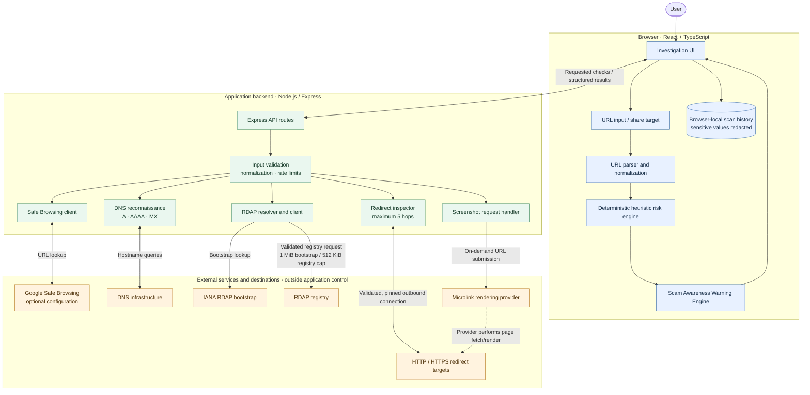

# Fraud Link Detector — System Architecture

Fraud Link Detector is a browser-based URL investigation interface backed by a Node.js/Express API. Deterministic URL parsing and heuristic scoring run in the browser. Network-dependent checks run on the server only when the corresponding feature is requested.

## Architecture diagram

The diagram separates the browser, application backend, and external services. The dashed boundary represents external infrastructure that the application does not control.

## Component responsibilities

| Component | Responsibility | Execution location |
|---|---|---|
| URL parser | Parse and normalize the submitted URL | Browser |
| Risk engine | Apply deterministic structural indicators and calculate a 0–100 score | Browser |
| Scam Awareness Warning Engine | Turn available evidence and check states into plain-English explanations | Browser |
| Express API | Expose analysis and reconnaissance endpoints | Server |
| Safe Browsing client | Query Google Safe Browsing when configured | Server |
| DNS reconnaissance | Resolve A, AAAA, and MX records | Server |
| RDAP client | Discover the registry endpoint and retrieve domain registration data | Server |
| Redirect inspector | Inspect HTTP redirect headers with bounded hops and outbound controls | Server |
| Screenshot handler | Request a preview from the external rendering provider when explicitly requested | Server + external provider |
| Scan history | Retain a limited, redacted history in browser storage | Browser |

## Trust boundaries and data flows

| Boundary | Data crossing it | Controls and caveats |
|---|---|---|
| Browser → application API | Submitted URL and requested analysis | Input validation, request body limits, rate limiting, no-store API responses |
| Application → Google Safe Browsing | Submitted URL, when configured | API key remains server-side; service can be unconfigured or unavailable |
| Application → DNS infrastructure | Hostname | Bounded DNS operations and timeouts |
| Application → IANA / RDAP registry | Domain and registry lookup requests | Destination validation, pinned outbound HTTPS connection, remote-address check, redirect revalidation, response byte limits |
| Application → redirect destination | URL and each redirect target | Special-use IP checks, connection pinning to validated IPs, hop and time limits |
| Application → screenshot provider | URL, only after the user requests a preview | Pre-flight DNS/IP checks; provider performs the actual page fetch and render on its own infrastructure |

## Security design notes

### Local analysis

- Heuristic scoring is deterministic and does not require a network request.
- A score is an indicator, not a probability or guarantee that a URL is malicious or safe.
- Missing or failed external checks are represented as unavailable or unconfigured, not as a clean verdict.

### Redirect inspection

- The inspector validates each redirect destination before the next connection.
- Outbound socket lookup is pinned to the address that passed validation.
- The implementation checks the connected socket's remote address against the pinned address.
- Inspection is headers-oriented; it does not execute JavaScript or browser-side meta-refresh navigation.

### RDAP reconnaissance

- IANA RDAP bootstrap responses are limited to **1 MiB**.
- Individual RDAP registry responses are limited to **512 KiB**.
- The stream reader counts actual bytes received as well as checking Content-Length when present, and cancels the stream when the cap is exceeded.
- Each registry destination, including redirect destinations, is validated before connecting; the socket address is pinned and checked.

### Screenshot preview limitation

Screenshot SSRF checks are pre-flight risk reduction, not an end-to-end socket-pinning guarantee. The external rendering provider resolves and connects to the submitted target on its own infrastructure. The provider's network behavior and data retention are outside the application's direct control.

## Deployment topology

- **Local development:** `server.ts` starts the standalone Node.js server.
- **Vercel:** `api/index.ts` and `api/[...route].ts` expose the Express handler through serverless function entrypoints.
- **Express app:** `src/server/app.ts` creates the modular application and configures routes, security headers, rate limiters, and error handling.

## Main source locations

- `api/index.ts` and `api/[...route].ts`: Vercel serverless entrypoints.
- `server.ts`: Standalone server entrypoint.
- `src/server/app.ts`: Express app factory, routes, security headers, rate limiters, and error handling.
- `src/server/safeBrowsing.ts`: URL validation, rate limiting, and Safe Browsing client.
- `src/server/dnsRecon.ts`: DNS and RDAP reconnaissance.
- `src/server/redirectInspector.ts`: Bounded redirect inspection and connection controls.
- `src/server/screenshotService.ts`: On-demand remote screenshot workflow and response validation.
- `src/utils/riskEngine.ts`: Deterministic URL risk scoring.
- `src/utils/warningEngine.ts`: Plain-English warning classification.

## Related documentation

- [Project case study](PROJECT-CASE-STUDY.md)
- [Safe demo guide](DEMO.md)
- [Root README](../README.md)
