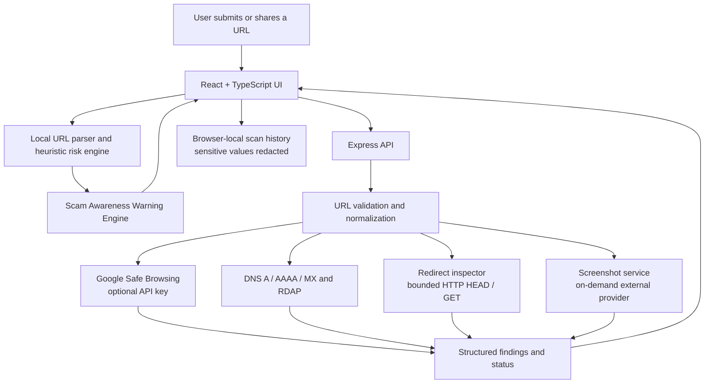

# Architecture

Fraud Link Detector is a browser-based investigation interface backed by a Node.js/Express API. The browser performs deterministic URL parsing and heuristic scoring locally. Network-dependent checks are performed by the server only when the corresponding feature is requested.

## Component and data-flow view

## Trust boundaries

| Boundary | Data crossing it | Controls and caveats |
|:---|:---|:---|
| Browser to application API | Submitted URL and requested analysis | URL validation, request body size limit, rate limiting, no-store API responses |
| Application to Google Safe Browsing | Submitted URL, when configured | API key stays on server; service can be unconfigured or unavailable |
| Application to DNS and RDAP infrastructure | Hostname/domain | Bounded DNS operations; registry coverage can vary |
| Application to redirect destinations | URL and redirect targets | Special-use IP checks, connection pinning to validated IPs, hop and time limits |
| Application to screenshot provider | URL, only after user requests a preview | DNS/IP pre-flight checks, provider image-host validation, redirects disabled on image fetch; provider performs the actual page render |

## Security design notes

- Local heuristic scoring is deterministic and does not require a network request.
- The redirect inspector validates each hop and pins its outbound socket lookup to the address that passed validation. It does not execute JavaScript or browser-side meta refresh navigation.
- DNS and external HTTP work is bounded by timeouts and request limits.
- Screenshot SSRF checks are pre-flight risk reduction, not an end-to-end socket-pinning guarantee: the external rendering provider resolves and connects to the submitted target on its own infrastructure.
- External-service failure or missing configuration must be represented as unavailable or unconfigured, not as proof that a URL is safe.

## Main source locations

- `server.ts`: Express app, API routes, middleware, and frontend serving.
- `src/server/safeBrowsing.ts`: URL validation, rate limiting, and Safe Browsing client.
- `src/server/dnsRecon.ts`: DNS and RDAP reconnaissance.
- `src/server/redirectInspector.ts`: bounded redirect inspection and connection controls.
- `src/server/screenshotService.ts`: on-demand remote screenshot workflow and response validation.
- `src/utils/riskEngine.ts`: deterministic URL risk scoring.
- `src/utils/warningEngine.ts`: plain-English warning classification.
