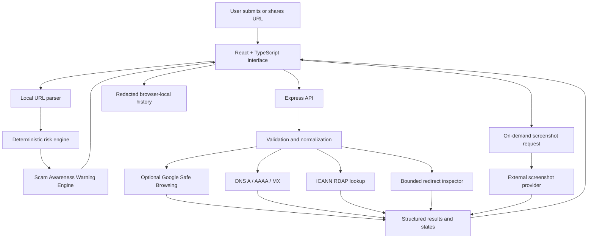

# Fraud Link Detector — Project Case Study

> A defensive cybersecurity investigation tool for analysing suspicious URLs without automatically opening the destination in the user's browser.

- **Repository:** https://github.com/aditya77288-web/fraud-link-detector
- **Live application:** https://fraud-link-detector-phi.vercel.app
- **Project type:** Full-stack web application / cybersecurity portfolio project
- **Status:** Active development

## 1. Executive Summary

Fraud Link Detector combines browser-side URL structure analysis with optional server-side reconnaissance to help users investigate suspicious links. It produces a transparent risk score, explains the structural indicators behind that score, and can supplement the local analysis with external threat intelligence, DNS and domain-registration data, and bounded HTTP redirect inspection.

The project is designed around an important security principle: a tool that inspects untrusted URLs must itself defend against those URLs. The backend therefore validates destinations and applies network and resource controls before making outbound requests. The application also explains when an external check is unavailable or unconfigured rather than treating a missing result as a clean verdict.

Fraud Link Detector is an investigative aid. It does not guarantee that a URL is safe and is not a replacement for endpoint protection, browser security controls, or a professional security assessment.

## 2. Problem and Objectives

Phishing links can disguise their destinations through embedded authority credentials, lookalike internationalized domains, deep subdomains, URL shorteners, suspicious query parameters, and redirect chains. A binary safe/unsafe label often hides the evidence a user needs to make an informed decision.

The project objectives are to:

1. Analyse URL structure locally and explain the indicators that affect the score.
2. Present plain-English warnings rather than relying only on a numeric result.
3. Add optional external context through threat intelligence, DNS, RDAP, and redirect inspection.
4. Avoid automatically navigating the user's browser to the submitted destination.
5. Reduce backend exposure to SSRF, DNS rebinding, oversized responses, and unbounded network work.
6. Communicate uncertainty, privacy boundaries, and feature limitations clearly.

## 3. System Architecture

The application uses a React and TypeScript client with a Node.js/Express API. It supports standalone local development and Vercel serverless deployment.



### Technology stack

| Layer | Technologies |
|---|---|
| Frontend | React 19, TypeScript, Vite, Tailwind CSS |
| Backend | Node.js, Express |
| URL analysis | Custom URL parser and deterministic heuristic engine |
| External threat intelligence | Google Safe Browsing v5 (optional server-side configuration) |
| Reconnaissance | Node DNS APIs and ICANN RDAP bootstrap/registry services |
| Redirect inspection | Node HTTP/HTTPS request handling |
| Screenshot preview | Microlink external rendering service, on explicit request |
| Testing | Node.js native test runner and TypeScript tooling |
| Hosting | Vercel serverless deployment |

## 4. Analysis Workflow

### 4.1 Local URL analysis

The browser parses and normalizes the submitted URL, then evaluates ten structural indicators:

- Insecure HTTP transport
- Direct IP address host
- Embedded authority credentials
- Excessive URL length
- Deep subdomain nesting
- Known URL shortener
- Sensitive words in host or path
- Sensitive query parameter patterns
- Punycode / internationalized domain labels
- Non-standard network port

The points are aggregated and clamped to a score from 0 to 100:

| Score | Displayed band |
|---:|---|
| 0–29 | Low |
| 30–59 | Medium |
| 60–100 | High |

These are heuristic indicators, not a probability that a link is malicious. For example, a normal `/login` path is not proof of phishing, and a low score does not establish that a URL is safe.

### 4.2 Scam Awareness Warning Engine

The warning engine combines local URL observations with available threat-intelligence, DNS/RDAP, and redirect-inspection states. It converts findings into explanations, confidence/severity labels, possible scam scenarios, and recommended actions.

The engine distinguishes confirmed external threat matches from suspicious structural evidence and contextual indicators. It also preserves unavailable and unconfigured states so that missing external data is not misrepresented as a clean result.

### 4.3 External checks

When requested and configured, the backend can:
- Query Google Safe Browsing for known threat matches.
- Resolve DNS A, AAAA, and MX records.
- Retrieve domain registration information through the IANA RDAP bootstrap and the appropriate registry endpoint.
- Inspect server-side HTTP redirect headers, with a maximum of five hops.
- Request a remote screenshot only after the user explicitly asks for the preview.

The redirect inspector is headers-oriented; it does not execute page JavaScript or follow browser-side meta-refresh navigation.

## 5. Security Engineering

A central engineering challenge is preventing the URL inspection service from becoming an SSRF primitive or an unbounded network client.

### 5.1 URL validation and restricted-address checks

Before outbound inspection, the server validates and normalizes the URL and checks resolved addresses against restricted or special-use ranges. Private, loopback, link-local, reserved, and other non-public destinations are rejected where applicable.

### 5.2 Redirect destination validation and connection pinning

The redirect inspection path validates each hop and uses a custom Node.js HTTP/HTTPS lookup to connect using the address that passed pre-flight validation. Redirect destinations are checked before the next connection. This is intended to reduce DNS-rebinding and time-of-check/time-of-use exposure.

### 5.3 RDAP response-size controls

RDAP bootstrap and registry responses are read with explicit byte limits:
- IANA RDAP bootstrap response: **1 MiB maximum**
- Individual RDAP registry response: **512 KiB maximum**

The reader checks Content-Length when supplied and also counts the actual bytes received from the stream. This covers responses without a useful Content-Length header, including chunked responses. When the limit is exceeded, the stream reader is cancelled rather than buffering the complete oversized response.

### 5.4 RDAP outbound connection validation

The RDAP outbound request path resolves and checks the destination before connecting, supplies a pinned address to the HTTPS lookup, and checks the connected socket's remote address against the validated address. Redirect destinations are revalidated before a subsequent connection. Standard TLS certificate/hostname verification remains enabled.

### 5.5 Bounded network activity

The project uses request validation, timeouts, rate limiting, redirect-hop limits, and bounded response handling to constrain network work. Exact controls differ by feature; see the implementation and tests for the current values.

### 5.6 Privacy and data handling

- Clipboard inspection is user-triggered; the app does not continuously monitor the clipboard.
- Shared and clipboard candidates require confirmation before scanning.
- Scan history is stored in browser storage with sensitive values redacted.
- API responses use no-store cache controls.
- API keys are intended to remain server-side and must not be committed to source control.
- Safe Browsing sends the submitted URL to Google when configured.
- DNS/RDAP and redirect checks generate external network requests.
- Screenshot preview sends the target URL to the external rendering provider only when explicitly requested. Provider-side processing and retention are outside the application's direct control.

## 6. Verification and Testing

The latest project checkpoint recorded **181 passing automated tests across 12 test specifications**, along with successful TypeScript checking, linting, and production build. These are project-reported verification results; the current CI workflow status should be checked in GitHub Actions before relying on them as a fresh run.

The test suite covers areas including:
- URL parsing, normalization, and heuristic scoring
- Browser-local scan history and sensitive-value redaction
- API route behavior and threat-intelligence states
- DNS and RDAP processing, timeouts, and response-size limits
- Redirect behavior, SSRF defenses, and connection-pinning logic
- Clipboard and Web Share Target parsing
- Screenshot response validation and streaming limits
- Scam-awareness warning classifications
- Vercel serverless API routing

Re-run the checks from the repository root before publishing a new release:

```bash
npm ci
npm test
npm run lint
npm run build
```

The CI badge in the root README links to the repository's current GitHub Actions status.

## 7. Demonstration

A safe demonstration can be performed using a benign domain such as `https://example.com`:

1. Start the application using the instructions in the root README or [Safe Demo Guide](DEMO.md).
2. Submit the benign URL and review the local score and rule explanations.
3. Review the status of optional external checks; an unconfigured provider should remain visibly unconfigured.
4. If testing network-dependent features, use only domains you own or are authorized to test.
5. Do not submit live malicious links, private URLs, credentials, or personal tokens to third-party services.

### Application screenshots

The repository includes these screenshots:

- Dashboard: [`dashboard-overview.png`](../docs/screenshots/dashboard-overview.png)
- Scan results: [`scan-results.png`](../docs/screenshots/scan-results.png)
- Redirect inspector: [`redirect-inspector.png`](../docs/screenshots/redirect-inspector.png)
- DNS/RDAP reconnaissance: [`dns-rdap-recon.png`](../docs/screenshots/dns-rdap-recon.png)

Use screenshots from the current build if the interface changes. Do not represent illustrative or synthetic values as live threat-intelligence findings.

## 8. Limitations and Future Work

### Current limitations

- Heuristic scores are indicators and cannot guarantee safety or detect every phishing campaign.
- Google Safe Browsing requires a valid server-side API key; otherwise its state is unconfigured.
- RDAP registry coverage and availability vary by domain registry.
- Redirect inspection is limited to server-side HTTP headers and does not execute JavaScript or browser navigation logic.
- Screenshot SSRF pre-flight checks cannot guarantee how the external rendering provider resolves and connects to the target.
- The project has not received an independent third-party security audit.

### Potential future improvements

- Add an end-to-end integration test that exercises a real local HTTPS server and verifies the actual connected socket address for the pinned RDAP connection path.
- Expand automated integration coverage for external-service failure and unusual registry responses.
- Continue improving accessibility, mobile usability, and the clarity of user-facing explanations.
- Add a documented, reproducible demo dataset and release checklist.

Future work should be prioritized based on demonstrated risk and user value rather than adding features solely to increase project size.

## 9. Project Learning Outcomes

This project brings together practical topics from web application development and defensive security engineering:

- URL parsing and the interpretation of web authority components
- Threat modelling for services that process attacker-controlled URLs
- SSRF and DNS-rebinding risk reduction
- HTTP redirect behavior and connection-level network controls
- DNS and domain-registration reconnaissance
- Safe handling of external API states and sensitive data
- Automated testing of security-sensitive behavior
- Communicating findings and limitations to non-specialist users

## 10. Links

- **Source code:** https://github.com/aditya77288-web/fraud-link-detector
- **Live application:** https://fraud-link-detector-phi.vercel.app
- **Architecture notes:** [ARCHITECTURE.md](ARCHITECTURE.md)
- **Safe demo instructions:** [DEMO.md](DEMO.md)
- **Security reporting:** [SECURITY.md](../SECURITY.md)
- **Root README:** [README.md](../README.md)

---

*This case study describes the implementation and verification evidence documented in the repository. It should be updated when features, test results, deployment behavior, or known limitations change.*
